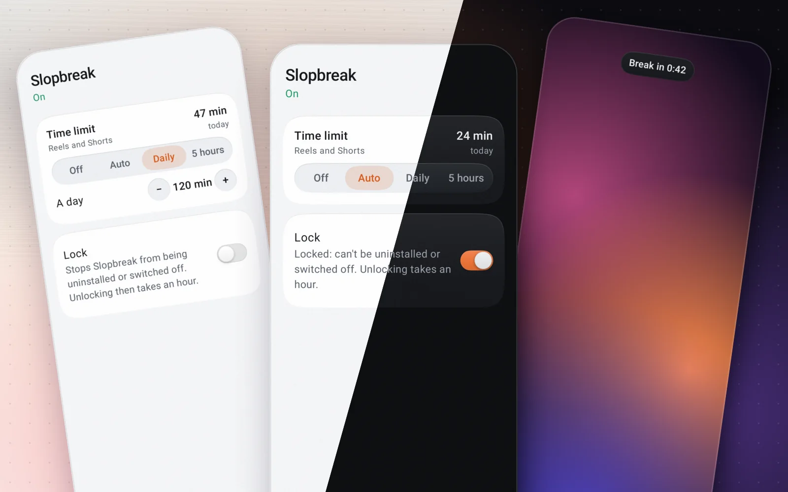

# Slopbreak

Time limits and forced breaks for Instagram Reels and YouTube Shorts. Messages, the feed, comments and normal videos stay free.



Android 11+. Works with Instagram and YouTube, including patched YouTube builds (ReVanced, Morphe, RVX).

## How it works

An accessibility service checks which app is in front and whether it is showing Reels or Shorts. It recognises them by the apps' view ids, so it works in any language. Only that time counts.

- **Auto**: a break after every 5 minutes. The first is 30 s and each one that day is longer, by 30 s at first and doubling every five breaks. At most 4 hours in any 5.
- **Daily** / **5 hours**: a fixed budget per day or per rolling 5 hours.
- Lowering a limit applies at once; raising it applies tomorrow.
- When time is up it presses Back out of Reels or Shorts and shows a countdown.
- **Lock** makes the app a device admin, so it can't be uninstalled, and backs out of the screens that would switch it off. Unlocking takes an hour. With no internet connection, nothing is enforced.

Nothing leaves the phone.

## Build

```
nix develop -c ./gradlew assembleRelease
adb install -t app/build/outputs/apk/release/app-release.apk
```

Without Nix you need JDK 17+ and the Android SDK (platform 37). The app is marked test-only so adb can always remove it, which is why `install` needs `-t`.

## adb

Uninstall, even when locked:

```
adb shell am broadcast -f 0x20 -a lt.neko.slopbreak.RELEASE -n lt.neko.slopbreak/.Adb
adb uninstall lt.neko.slopbreak
```

If that ever fails, `adb shell dpm remove-active-admin lt.neko.slopbreak/.protect.Admin` does the same without the app's help.

Clear today's usage and breaks:

```
adb shell am broadcast -f 0x20 -a lt.neko.slopbreak.RESET -n lt.neko.slopbreak/.Adb
```

Show the developer section (or tap the title seven times):

```
adb shell am broadcast -f 0x20 -a lt.neko.slopbreak.DEVELOPER --ez on true -n lt.neko.slopbreak/.Adb
```

Its record button marks screens as Block or Keep and saves each one's view tree and a screenshot to `/sdcard/Android/data/lt.neko.slopbreak/files/recordings`, for working out detection rules.

## License

BSD 2-Clause. See [LICENSE](LICENSE).
